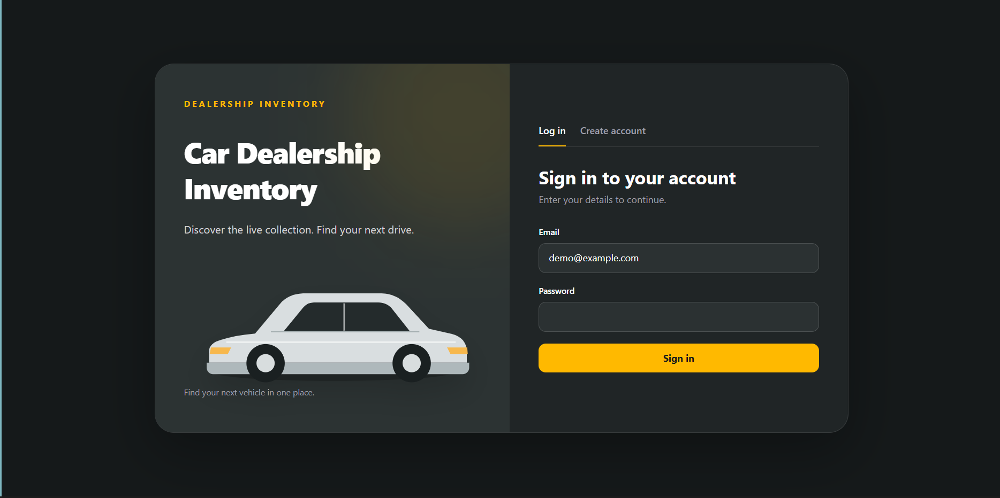
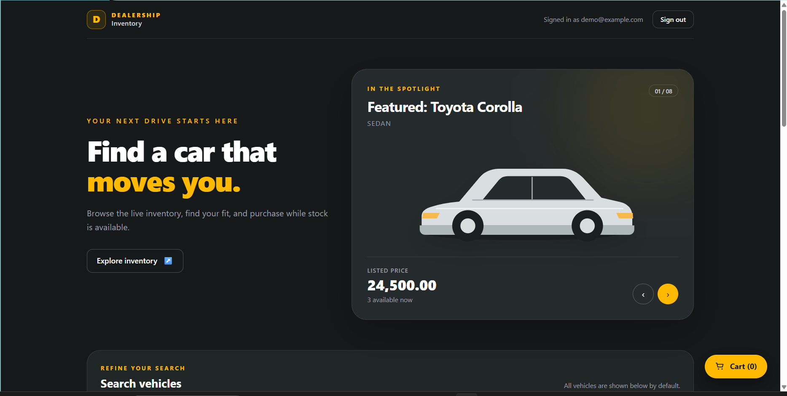
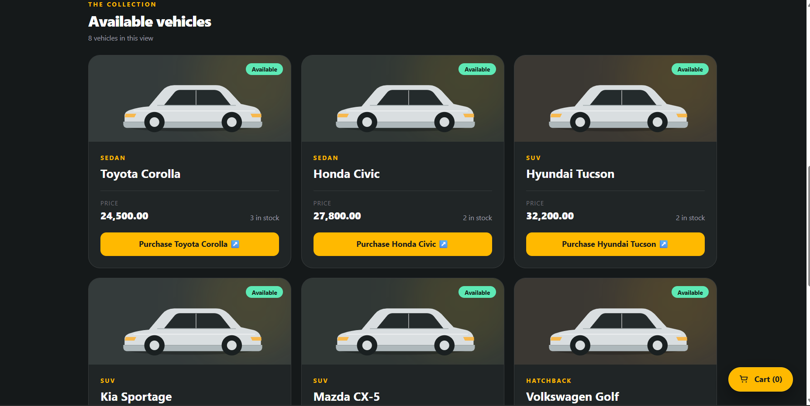
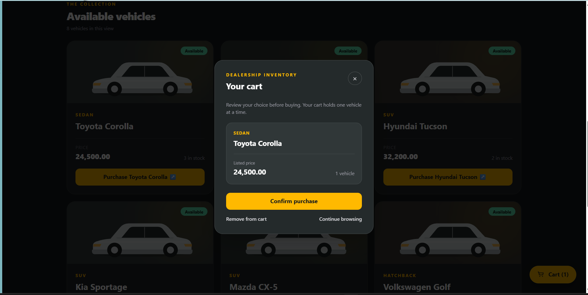
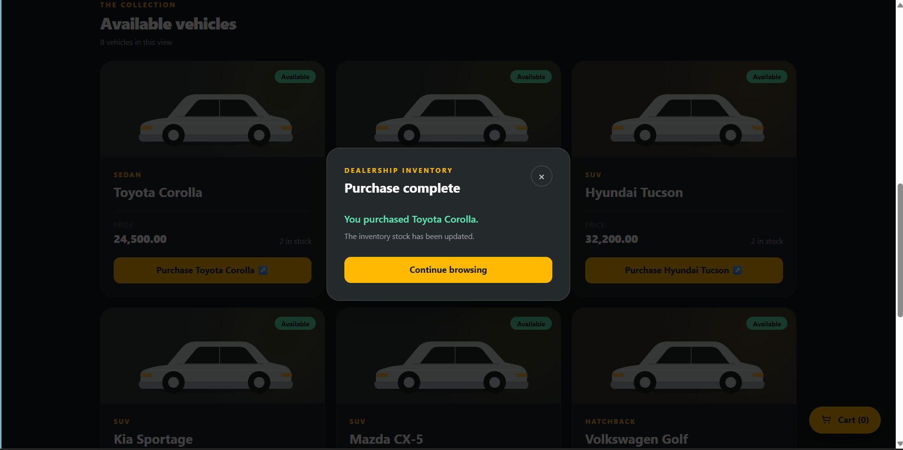
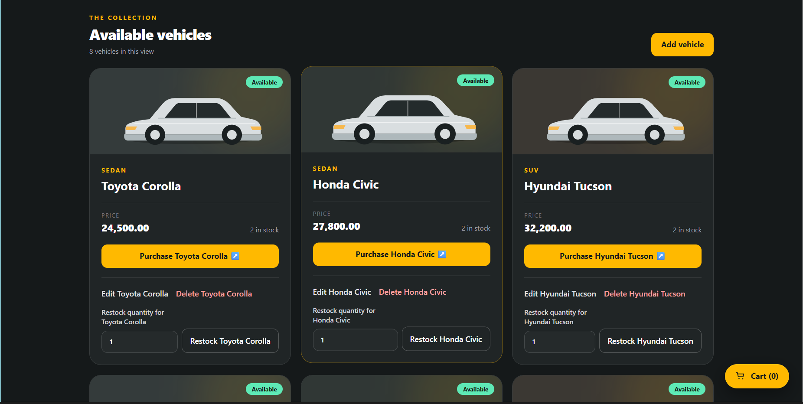

# Car Dealership Inventory System

An assessment project for managing a dealership's vehicles and stock. The application has a FastAPI API backed by PostgreSQL and a React single-page frontend.

## Project status

The backend supports user registration, JWT login, a local first-admin setup command, authenticated vehicle browsing, search, and purchase, plus admin-only vehicle creation, update, deletion, and restock. The frontend now supports registration, login, vehicle browsing and search, purchase, and admin vehicle management. See [the development plan](docs/DEVELOPMENT_PLAN.md).

## Requirements

- Python 3.13 or compatible Python 3.11+
- Node.js 20.19+ or 22.12+ and npm
- A running PostgreSQL server and access through pgAdmin or another client

## Local setup

1. In pgAdmin, connect to your PostgreSQL server and create separate `car_dealership_dev` and `car_dealership_test` databases.
2. Copy `backend/.env.example` to `backend/.env` and fill in your local PostgreSQL username, password, host, and port. Use the development database for `DATABASE_URL` and the test database for `TEST_DATABASE_URL`. Set `JWT_SECRET` to a random secret generated locally, for example with `python -c "import secrets; print(secrets.token_urlsafe(48))"`. Do not commit `backend/.env`.
3. In `backend`, create a virtual environment, activate it, and run `python -m pip install -e ".[dev]"` after dependency installation is approved.
4. In `backend`, create the `users` and `vehicles` tables in each database before using the API or running tests. For the development database, run `python -c "from app.models import Base; from app.database import get_engine; Base.metadata.create_all(get_engine())"`. For the test database, run `python -c "from dotenv import dotenv_values; from sqlalchemy import create_engine; from app.models import Base; Base.metadata.create_all(create_engine(dotenv_values('.env')['TEST_DATABASE_URL']))"`. Run `uvicorn app.main:app --reload` to start the API.
5. Copy `frontend/.env.example` to `frontend/.env`. In `frontend`, run `npm install` after dependency installation is approved, then `npm run dev`. Open the URL printed by Vite (normally `http://localhost:5173`). Choose **Create account** to register, then sign in with the same credentials to open the inventory.

The frontend defaults to `http://localhost:8000` for API requests and runs at `http://localhost:5173`. The backend allows that origin by default.

There are no default admin credentials. Public registration creates regular users. To create the first admin, set `DATABASE_URL` to your development database in `backend/.env`, then run this once from `backend`:

```powershell
.\.venv\Scripts\python.exe -m app.admin_setup --email you@example.com
```

The command prompts for the password without putting it in shell history. It refuses to change an existing user or create a second admin. Do not run it against the test database. The command changes the database, so get approval before running it.

Log out and sign in with the new admin email and password to see add, edit, delete, and restock controls. The login response supplies the role to the frontend, while the backend continues to enforce admin permission on every protected operation.

To make a fresh development inventory useful immediately, run `.\.venv\Scripts\python.exe -m app.seed_vehicles` from `backend` in PowerShell. It adds eight illustrative vehicles as real rows in the `vehicles` table only when `car_dealership_dev` has no vehicles; rerunning it or using it with existing inventory leaves that inventory unchanged. The frontend fetches these rows through the same protected API used for admin-created cars. Users can purchase them, which persists the reduced stock, and admins can edit, delete, or restock them. The prices are demo values, not live offers. All signed-in users see these cars on the inventory page without searching first.

Authenticated users can list vehicles with `GET /api/vehicles` and filter with `GET /api/vehicles/search`. Search accepts optional `make`, `model`, `category`, `min_price`, and `max_price` query parameters. Text filters match part of a value without case sensitivity; price bounds are inclusive. Multiple filters combine.

Authenticated users can retrieve one vehicle with `GET /api/vehicles/{id}`. Admins can replace a vehicle's details with `PUT /api/vehicles/{id}` using all five vehicle fields, or remove one with `DELETE /api/vehicles/{id}`. Unknown IDs return `404`. Search rejects negative or reversed price bounds with `422`.

An authenticated user can call `POST /api/vehicles/{id}/purchase` to buy one vehicle and decrease stock by one. In the frontend, a vehicle's Purchase button opens a one-car cart for review; stock changes only after **Confirm purchase**. The cart shows a clear success or API error message and does not take payment or create an order record. A zero-stock purchase returns `409`; competing purchases cannot make stock negative. An admin can call `POST /api/vehicles/{id}/restock` with a JSON body such as `{"quantity": 5}` to add a positive whole number to stock.

## Tests

After dependencies are installed and both databases have their tables, run `python -m pytest -q --tb=short` from `backend`, then `npm test -- --run` and `npm run build` from `frontend`. The build runs `tsc --noEmit` before Vite. Backend tests write records to `car_dealership_test`; they check that its URL differs from the development URL and that the database name is `car_dealership_test`.

### Test report

Foundation checks on 24 October 2026:

| Command | Observed result |
| --- | --- |
| `python -m pytest -q` in `backend` | 1 passed, 1 dependency deprecation warning |
| `npm test -- --run` in `frontend` | 1 test passed |
| `npm run build` in `frontend` | TypeScript check and Vite production build passed |
| `npm audit --audit-level=moderate` in `frontend` | 0 reported vulnerabilities |

Backend check after vehicle creation: `python -m pytest -q` on 25 October 2026 returned **41 passed, 1 dependency deprecation warning**. The foundation checks above remain as the original milestone report.

Backend check after first-admin setup, listing, and search: `.\.venv\Scripts\python.exe -m pytest -q --tb=line` on 25 October 2026 returned **53 passed, 1 dependency deprecation warning**.

Backend check after vehicle details, update, delete, and search validation: `.\.venv\Scripts\python.exe -m pytest -q --tb=short` on 25 October 2026 returned **72 passed, 1 dependency deprecation warning**.

Latest backend check after purchase and restock: `.\.venv\Scripts\python.exe -m pytest -q --tb=short` on 25 October 2026 returned **87 passed, 1 dependency deprecation warning**.

Frontend authentication check on 25 October 2026: `npm test -- --run src/App.test.tsx` returned **5 passed**. `npm run build` also passed.

Inventory UI check on 25 October 2026: `npm test -- --run src/App.test.tsx src/Inventory.test.tsx` returned **11 passed**; `npm run build` passed. The full backend suite returned **88 passed, 1 dependency deprecation warning**.

Sample inventory check on 25 October 2026: `.\.venv\Scripts\python.exe -m pytest -q tests/test_seed_vehicles.py --tb=short` returned **4 passed, 1 dependency deprecation warning**. The seed command added **8 sample vehicles** to the empty development inventory. One test verifies a registered user can list and purchase a seeded vehicle and that the lower stock persists.

Cart UI check on 25 October 2026: `npm test -- --run` returned **14 passed**. `npm run build` passed. Tests cover review before purchase, removal without an API request, successful confirmation, and a failed purchase that keeps the car in the cart.

Final local regression check on 25 October 2026, after adding the whole-workflow API test:

| Command | Observed result |
| --- | --- |
| `.\.venv\Scripts\python.exe -m pytest -q --tb=short` in `backend` | 93 passed, 1 Starlette/HTTPX dependency deprecation warning |
| `.\.venv\Scripts\python.exe -m pytest -q tests/test_full_workflow.py --tb=short` in `backend` | 1 passed, same warning |
| `npm test -- --run` in `frontend` | 14 passed across 2 files |
| `npm run build` in `frontend` | TypeScript check and Vite production build passed |

The whole-workflow test uses the real PostgreSQL test database. It covers public registration, login, user/admin access, create, list, combined search, purchase and persisted stock, restock, update, and delete. A browser check against a separate API server pointed at that same test database also completed registration, login, search, cart confirmation, purchase, and admin create/edit/restock/delete. The test database already contained rows from earlier test runs, so the browser check filtered to the relevant vehicles. No payment or order record is part of this kata.

## Screenshots

These desktop screenshots were captured from the local app by the project owner:

| Screen | Screenshot |
| --- | --- |
| Sign-in page |  |
| Customer showroom |  |
| Vehicle inventory |  |
| One-car cart before confirmation |  |
| Purchase confirmation |  |
| Admin vehicle controls |  |

## My AI Usage

I used **Codex** throughout this assessment. It helped turn the brief into a small development plan, scaffold the FastAPI and React projects, draft tests before business features, implement the API and UI in reviewable slices, and investigate test and integration results. I used it again to run the final test commands, walk through the app in a browser, and prepare this report and screenshots. I did not use AI to invent test results or screenshots.

The most useful part of the workflow was the red, green, refactor rhythm. Tests made each endpoint's expected behavior concrete before implementation, and the final browser walkthrough checked that the separate pieces worked together. I reviewed the generated code against the assignment and access rules, kept PostgreSQL as the source of truth for stock, and checked the actual command output and browser state. AI sped up repetitive setup and helped expose integration assumptions, but its suggestions still needed verification: mocked frontend tests alone could not prove the live API flow, and an initial sandbox error was an execution restriction rather than a code failure.

Before submission, I will review this reflection in my own words and check the AI chat links in [PROMPTS.md](PROMPTS.md). AI-assisted commits include the assignment's `Co-authored-by: Codex <codex@openai.com>` trailer after two blank lines.

## Repository

Public repository URL: https://github.com/AkshdeepSingh2006/car-dealership-inventory

