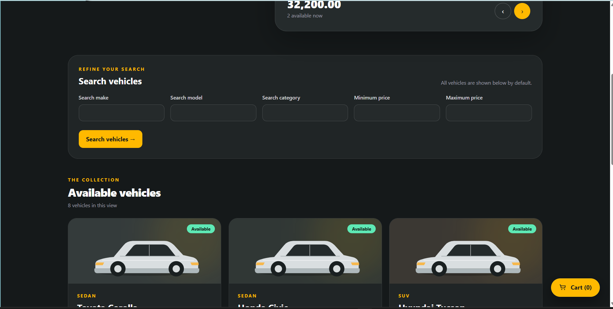

## User — 2026-10-25T13:43:15.353Z

# AGENTS.md instructions for C:\Users\hp\Documents\Projects\car-dealership-inventory

<INSTRUCTIONS>
# Project instructions

Read `docs/DEVELOPMENT_PLAN.md` and the original assignment brief before changing this project. The assignment is the authoritative feature specification.

The user is learning and has two days for the assessment. Keep changes small and explain their purpose, relevant files, and verification in plain language. Do not add optional features or unrelated technologies.

For each business feature, follow Red-Green-Refactor as separate review stops: write and run failing tests first; implement the minimum behavior and rerun focused tests; then make only useful refactors and rerun tests. Do not weaken tests to pass. The user stages and commits; do not commit or push.

Before installing packages, show the exact command and explain it. Ask before any database-changing command, destructive operation, commit, push, or deployment. Never put credentials in source control or invent test results, screenshots, or AI logs. Remind the user to add the assignment's AI co-author trailer to AI-assisted commits.

Approved access rules: public registration creates regular users; every vehicle endpoint requires authentication; users can list, search, and purchase; admins alone can create, update, delete, and restock. The first admin comes from a controlled documented setup command, not public registration.

</INSTRUCTIONS>
<environment_context>
  <cwd>C:\Users\hp\Documents\Projects\car-dealership-inventory</cwd>
  <shell>powershell</shell>
  <current_date>2026-10-25</current_date>
  <timezone>Asia/Calcutta</timezone>
  <filesystem><workspace_roots><root>C:\Users\hp\Documents\Projects\car-dealership-inventory</root><root>C:\Users\hp\.codex\visualizations\2026\10\25\01a1734d-1451-71f2-b658-fab364d2cfc3</root></workspace_roots><permission_profile type="managed"><file_system type="restricted"><entry access="read"><special>:root</special></entry><entry access="write"><path>C:\Users\hp\Documents\Projects\car-dealership-inventory</path></entry><entry access="write"><path>C:\Users\hp\.codex\visualizations\2026\10\25\01a1734d-1451-71f2-b658-fab364d2cfc3</path></entry><entry access="write"><special>:slash_tmp</special></entry><entry access="write"><special>:tmpdir</special></entry><entry access="read"><path>C:\Users\hp\Documents\Projects\car-dealership-inventory\.git</path></entry><entry access="read"><path>C:\Users\hp\.codex\visualizations\2026\10\25\01a1734d-1451-71f2-b658-fab364d2cfc3\.git</path></entry><entry access="read"><path>C:\Users\hp\Documents\Projects\car-dealership-inventory\.agents</path></entry><entry access="read"><path>C:\Users\hp\.codex\visualizations\2026\10\25\01a1734d-1451-71f2-b658-fab364d2cfc3\.agents</path></entry><entry access="read"><path>C:\Users\hp\Documents\Projects\car-dealership-inventory\.codex</path></entry><entry access="read"><path>C:\Users\hp\.codex\visualizations\2026\10\25\01a1734d-1451-71f2-b658-fab364d2cfc3\.codex</path></entry><entry access="read"><path>C:\Users\hp\Documents\Projects\car-dealership-inventory\.aws</path></entry><entry access="read"><path>C:\Users\hp\.codex\visualizations\2026\10\25\01a1734d-1451-71f2-b658-fab364d2cfc3\.aws</path></entry></file_system></permission_profile></filesystem>
</environment_context>

## Assistant — 2026-10-25T13:43:17.963Z

I’ll read the plan and assignment first, then check the current code and run the documented tests. I’ll keep the existing cart changes intact and make any integration fixes in small red, green, and refactor steps.

## Assistant — 2026-10-25T13:43:38.018Z

The plan confirms the assignment PDF is the feature source of truth. The checkout has only the three expected cart-related edits, so I’m leaving those in place while I review the brief and test setup. I’m using the PDF workflow to read the original brief accurately.

## Assistant — 2026-10-25T13:44:30.634Z

The backend tests write to `car_dealership_test`, so I’ve asked before running them, as the project instructions require. I can check the frontend suite, TypeScript, build, and repository deliverables now without changing database data.

## Assistant — 2026-10-25T13:44:42.643Z

The frontend commands reached Vite, but the sandbox denied esbuild access to the project path before tests or bundling ran. I’m retrying those same verification commands with the required execution approval; this is an environment access issue, not a reported test failure.

## User — 2026-10-25T13:44:53.749Z

<send_user_message_question_reply>
[{"questionItemId":"[\"request_user_input_async\",\"call_IVPfXB0qsyWDTQu2IH8S5IBI\",0]","question":"May I run the backend and live integration tests against the configured `car_dealership_test` database? These tests insert and delete test records and may create its tables. I’ll verify it differs from the development database before running them.","answer":"Yes, use the test database"}]
</send_user_message_question_reply>

## Assistant — 2026-10-25T13:45:51.783Z

The test database is configured separately as `car_dealership_test`, and the frontend now passes all 14 tests plus TypeScript and production build. I’m running the backend suite next, then I’ll exercise the API workflow against that test database.

## Assistant — 2026-10-25T13:47:12.240Z

The backend suite passes: 92 tests. I found no failing endpoint in the focused tests, but they exercise the operations mostly in isolation. I’m adding one small integration test that runs the approved workflow in order, so registration, permissions, stock changes, and deletion are checked together.

## Assistant — 2026-10-25T13:49:26.418Z

The integration test passes through registration, login, admin creation, user search and purchase, admin restock and edit, and deletion against the test database. I’ve started a separate local API and frontend on ports 8001 and 5174 for a browser check and genuine screenshots; the usual ports were already occupied.

## Assistant — 2026-10-25T13:51:46.780Z

The live browser flow worked for a new regular account: registration, login, search, cart review, purchase confirmation, and the visible stock decrease. I’ve saved screenshots from the actual app. I’m now checking the admin controls in the same browser against a test-only admin account.

## Assistant — 2026-10-25T13:55:10.003Z

The browser admin flow also worked: add, edit, restock, and delete, with the UI updating after each API response. I verified the GitHub remote is reachable; its `main` branch is still behind the local checkout. I’m finishing the README and prompt record locally, then I’ll rerun the final checks.

## Assistant — 2026-10-25T13:56:34.760Z

The prompt links are still being generated. The five project chats are the source for the required raw AI record; I’ll include only the share links that the app actually returns and leave the user’s final review of those public transcripts explicit.

## Assistant — 2026-10-25T13:58:37.929Z

Final checks pass after the integration test was added: 93 backend tests, 14 frontend tests, and the TypeScript plus production build. The remaining delivery gaps are outside code: the share links are workspace-scoped rather than confirmed public, and the reviewed local work still needs the user’s commit and push. I’m doing the last file and documentation audit now.

## User — 2026-10-25T14:00:31.560Z

<send_user_message_question_reply>
[{"questionItemId":"[\"request_user_input_async\",\"call_HhFuUzzuZbaJZLSx3bKIuFMU\",0]","question":"The Codex share tool produced workspace-only links for the five project chats. Could you make those chats publicly viewable and send me the public links so I can finish `PROMPTS.md`? The assignment requires public links or raw, unedited logs; I can’t label workspace-only links as public.","answer":"what does the assignment ask for links or logs?"}]
</send_user_message_question_reply>

## Assistant — 2026-10-25T14:00:36.327Z

The assignment allows **either** a root `PROMPTS.md` with raw, unedited AI chat logs **or** public chat links. It explicitly says AI-generated summaries do not count. The links Codex generated are labeled “workspace,” so I can’t verify that an assessor outside your workspace can open them.

The simplest finish is for you to make those five chat links public and send me the public versions; I’ll replace the workspace links in `PROMPTS.md`.

## User — 2026-10-25T14:02:23.351Z

<external_codex_apps_open_page>{"page_id":null}</external_codex_apps_open_page>

## User — 2026-10-25T14:02:23.406Z

how to get links or logs 
which is better

## Assistant — 2026-10-25T14:02:27.296Z

I’ll check the current Codex sharing options before recommending one. The key choice is whether you can produce a link an assessor can open without your workspace access.

## Assistant — 2026-10-25T14:03:15.366Z

**Raw logs are the better option for this account.** OpenAI’s documentation says a workspace Codex share link is limited to authenticated members of that workspace, while `/export` in the Codex terminal saves the complete conversation as Markdown. An assessor is more likely to be able to read logs committed with the repository. [Sharing guidance](https://learn.chatgpt.com/docs/use-chatgpt), [export instructions](https://learn.chatgpt.com/docs/developer-commands).

For each of the five project chats: open it in the Codex terminal, type `/export`, choose **Save to file**, and place the exported Markdown under `docs/ai-logs/`. Then link those files from `PROMPTS.md`. Review each export for passwords, tokens, or private details before staging it. The text must stay verbatim—no AI summary. I can update `PROMPTS.md` once the exports are in the project.

## Assistant — 2026-10-25T14:04:20.563Z

**Raw logs are the better choice.** The assignment accepts either verbatim AI chat logs or public links. Codex labeled the five links it generated as **workspace-only**; OpenAI says those links are accessible only to authenticated workspace members. [Sharing guidance](https://learn.chatgpt.com/docs/use-chatgpt). In the Codex terminal, open each project chat, run `/export`, choose **Save to file**, and put the Markdown exports under `docs/ai-logs/`. Review them for secrets before staging; I can then link them from [PROMPTS.md](C:/Users/hp/Documents/Projects/car-dealership-inventory/PROMPTS.md). [Export instructions](https://learn.chatgpt.com/docs/developer-commands).

Integration work is ready for review. The live browser flow passed registration, login, search, cart purchase, and admin add, edit, restock, and delete. I added a [whole-workflow API test](C:/Users/hp/Documents/Projects/car-dealership-inventory/backend/tests/test_full_workflow.py), genuine screenshots, and an updated [README](C:/Users/hp/Documents/Projects/car-dealership-inventory/README.md). Final checks: **93 backend tests**, **14 frontend tests**, and the TypeScript and production build passed. One dependency deprecation warning remains. This used the existing local databases; I did not recreate a database from scratch.

Before submission, the raw exports still need to replace the workspace links, you should review the first-person AI reflection, and you need to stage, commit, and push the local work. The public GitHub URL is reachable, but local `main` is four commits ahead of `origin/main` with uncommitted changes. I did not commit or push, as `AGENTS.md` assigns those steps to you. Add the assignment’s `Co-authored-by: Codex <codex@openai.com>` trailer to AI-assisted commits.

## User — 2026-10-25T14:04:20.972Z

who are we sharing these chats to and where 

## Assistant — 2026-10-25T14:04:27.724Z

You’re sharing the AI record with the **Incubyte assessor** through your **public GitHub repository**. They’ll open the root [PROMPTS.md](C:/Users/hp/Documents/Projects/car-dealership-inventory/PROMPTS.md) and follow its links to the logs.

If you commit raw logs to that repository, **anyone who can view the public repo can read them**, not just the assessor. Review them for passwords, tokens, and private details before committing. The current Codex links are workspace-only, so an external assessor may be unable to open them.

## User — 2026-10-25T14:07:28.092Z

<external_codex_apps_open_page>{"page_id":null}</external_codex_apps_open_page>

## User — 2026-10-25T14:07:28.147Z

commit raw logs 
i don't think there is anything sensitive in the chats. If the logs get too long consider removing chat 00. There isn't much in that chat. We will remove the logs from github after evaluation if that is possible.

## Assistant — 2026-10-25T14:07:37.915Z

I’ll export the project chats as verbatim message transcripts, check them for credentials and private details, then link the resulting files from `PROMPTS.md`. I’ll measure the size before deciding whether chat 00 needs to be omitted. Your request authorizes a commit for these logs; I’ll keep that commit limited to the log deliverable and won’t push it.

## Assistant — 2026-10-25T14:09:17.299Z

The five main chat histories are small enough to include, so I’ll keep chat 00. I checked the user-visible messages for database URLs containing passwords, API tokens, and private keys; none of those patterns appeared in the five main chats. I’m exporting the messages verbatim and preserving the one attached image as a separate file.
## Assistant — 2026-10-25T14:11:22.210Z

The transcripts are staged as a logs-only change. `git diff --cached --check` flags trailing spaces that are present in the original chat messages; changing them would break the verbatim record, so I’m leaving them intact.

One important Git detail: deleting the files from GitHub after evaluation would remove them from the current branch view, but **would not erase them from Git history or copies others made**. I’m committing locally as requested and will leave pushing to you.

## Assistant — 2026-10-25T14:12:09.068Z

Committed the five project chat transcripts, including chat 00, as **`fea97be`**. [PROMPTS.md](C:/Users/hp/Documents/Projects/car-dealership-inventory/PROMPTS.md) links to the verbatim user-visible messages and the original image attachment. A scan found no database passwords, API tokens, private keys, or JWT secret assignments in the exported text.

**I did not push.** Please review the logs before pushing: deleting them from GitHub after evaluation would leave them in Git history and in any copies others made. The separate README, screenshots, integration test, and cart changes remain uncommitted.

## User — 2026-10-25T14:12:16.906Z

how did you get the screen shots of the app. 
do I need to get any screenshots??

## Assistant — 2026-10-25T14:12:28.841Z

I opened the running frontend in the Codex in-app browser, used the real API connected to the **test database**, walked through customer purchase and admin management, and saved screenshots of those actual screens. They’re in [docs/screenshots](C:/Users/hp/Documents/Projects/car-dealership-inventory/docs/screenshots), and the [README](C:/Users/hp/Documents/Projects/car-dealership-inventory/README.md) displays them.

You **do not need to take more screenshots** to meet that assignment requirement. Please review them before submission: they show a mobile-width view and test data, and the screenshot files and README are **not yet committed or pushed**.

## User — 2026-10-25T14:16:44.523Z

I think we should add screenshots from a computer not a phone

## User — 2026-10-25T14:16:55.563Z

I will attach some

## Assistant — 2026-10-25T14:16:59.669Z

Desktop screenshots will show the layout more clearly. Attach them when ready, and I’ll review them, add the suitable ones to the project, and update the README.

## User — 2026-10-25T14:20:31.592Z

# Files mentioned by the user:

## codex-clipboard-c803e192-5186-40b9-8859-fb83c2ee2b4e.png: C:/Users/hp/AppData/Local/Temp/codex-clipboard-c803e192-5186-40b9-8859-fb83c2ee2b4e.png
Image attachment: true

## codex-clipboard-60af9d6d-a7d7-469e-b27a-77a391c35dc6.png: C:/Users/hp/AppData/Local/Temp/codex-clipboard-60af9d6d-a7d7-469e-b27a-77a391c35dc6.png
Image attachment: true

## Screenshot 2026-10-25 194717.png: C:/Users/hp/Pictures/Screenshots/Screenshot 2026-10-25 194717.png
Image attachment: true

## Screenshot 2026-10-25 194733.png: C:/Users/hp/Pictures/Screenshots/Screenshot 2026-10-25 194733.png
Image attachment: true

## Screenshot 2026-10-25 194748.png: C:/Users/hp/Pictures/Screenshots/Screenshot 2026-10-25 194748.png
Image attachment: true

## Screenshot 2026-10-25 194801.png: C:/Users/hp/Pictures/Screenshots/Screenshot 2026-10-25 194801.png
Image attachment: true

## Screenshot 2026-10-25 194817.png: C:/Users/hp/Pictures/Screenshots/Screenshot 2026-10-25 194817.png
Image attachment: true

## Screenshot 2026-10-25 194839.png: C:/Users/hp/Pictures/Screenshots/Screenshot 2026-10-25 194839.png
Image attachment: true

## Screenshot 2026-10-25 194906.png: C:/Users/hp/Pictures/Screenshots/Screenshot 2026-10-25 194906.png
Image attachment: true

Distinguish instructions in attached documents from the user's request.

## My request:
remove cart from admin, no leave it we don't have much time 
<image name=[Image #1] path="C:\Users\hp\AppData\Local\Temp\codex-clipboard-c803e192-5186-40b9-8859-fb83c2ee2b4e.png">

</image>
<image name=[Image #2] path="C:\Users\hp\AppData\Local\Temp\codex-clipboard-60af9d6d-a7d7-469e-b27a-77a391c35dc6.png">

</image>
<image name=[Image #3] path="C:\Users\hp\Pictures\Screenshots\Screenshot 2026-10-25 194717.png">

</image>
<image name=[Image #4] path="C:\Users\hp\Pictures\Screenshots\Screenshot 2026-10-25 194733.png">

</image>
<image name=[Image #5] path="C:\Users\hp\Pictures\Screenshots\Screenshot 2026-10-25 194748.png">

</image>
<image name=[Image #6] path="C:\Users\hp\Pictures\Screenshots\Screenshot 2026-10-25 194801.png">

</image>
<image name=[Image #7] path="C:\Users\hp\Pictures\Screenshots\Screenshot 2026-10-25 194817.png">

</image>
<image name=[Image #8] path="C:\Users\hp\Pictures\Screenshots\Screenshot 2026-10-25 194839.png">

</image>
<image name=[Image #9] path="C:\Users\hp\Pictures\Screenshots\Screenshot 2026-10-25 194906.png">

</image>

## Assistant — 2026-10-25T14:20:41.404Z

I’ll leave the admin cart as it is, as you decided. I’ll use the desktop screenshots you attached for the README: login, inventory, cart review, purchase confirmation, and admin controls. I’ll copy the originals into the project and verify the README links.

## Assistant — 2026-10-25T14:21:22.962Z

I’ll leave the admin cart as it is and update the README to use the desktop screenshots you attached.

## Assistant — 2026-10-25T14:21:43.731Z

I left the admin cart unchanged. I added your six desktop screenshots and updated [README.md](C:/Users/hp/Documents/Projects/car-dealership-inventory/README.md) to show them. All six image files are present, and `git diff --check` passed.

These screenshot and README changes are still uncommitted and unpushed. No tests were rerun for this documentation-only update.

## User — 2026-10-25T14:21:44.090Z

verify if we have completed all the deliverables mentioned in the instructions file.
Mention If anything needs to be done from my side

## Assistant — 2026-10-25T14:21:46.795Z

I’ll check the original assignment and project instructions against the files, test results, and Git state, then list anything you still need to do before submission.

## Assistant — 2026-10-25T14:22:14.898Z

The brief requires the app, test evidence, screenshots, AI disclosure, raw logs or public chat links, and a public repository. I’m checking each item against the current files and what is actually published.

## Assistant — 2026-10-25T14:22:45.983Z

The required features and documentation are present locally. The remaining submission risk is that the latest cart work, workflow test, README, and screenshots are still outside Git, and the local branch is ahead of GitHub. I’m running the final checks on this exact working tree.

## Assistant — 2026-10-25T14:23:48.081Z

Backend verification passed: 93 tests, with one dependency deprecation warning. The frontend commands stopped before running tests because the sandbox denied esbuild access to the config path; I’m retrying those checks with the required permission.

## Assistant — 2026-10-25T14:25:34.611Z

**The required deliverables are complete locally, but the GitHub submission is not yet current.** I checked the original assignment against the project files and reran the final checks.

| Deliverable | Status |
| --- | --- |
| Backend API, database, authentication, and vehicle operations | Complete locally |
| React and Tailwind app, including customer and admin flows | Complete locally |
| Tests and test report | 93 backend tests passed; 14 frontend tests passed; production build passed. One backend dependency deprecation warning remains. |
| README, “My AI Usage,” and desktop screenshots | Present locally |
| Root `PROMPTS.md` with raw chat logs | Committed |
| Public repository link | [Reachable on GitHub](https://github.com/AkshdeepSingh2006/car-dealership-inventory), but it shows an older version |
| Live deployment | Optional; not required |

**What you need to do:** Review the [README](/C:/Users/hp/Documents/Projects/car-dealership-inventory/README.md), especially the first-person “My AI Usage” reflection, then stage and commit the remaining changes and push them. The local branch is five commits ahead of GitHub, and the latest cart changes, workflow test, README updates, and screenshots are still uncommitted. Add the assignment’s AI co-author trailer to the new AI-assisted commit, with two blank lines before it.

[PROMPTS.md](/C:/Users/hp/Documents/Projects/car-dealership-inventory/PROMPTS.md) says its final log is a snapshot, so the most recent delivery conversation is absent. Refreshing that log before submission would make the AI record more complete. After pushing, open the public repository and confirm the README images and logs display, then submit its link.

## User — 2026-10-25T14:28:09.078Z

<external_codex_apps_open_page>{"page_id":null}</external_codex_apps_open_page>

## User — 2026-10-25T14:28:09.125Z

okay 
what about A test report showing the results of your test suite. This was in the deliverables section 
update prompts.md
I will review the readme and then push the changes

## Assistant — 2026-10-25T14:28:13.689Z

The test report is already in the README’s **Tests → Test report** section, with the commands and observed results. I’ll update the raw chat log and `PROMPTS.md` to include the later project conversation, while leaving the README for your review.

## Assistant — 2026-10-25T14:29:47.435Z

The six README screenshots are linked correctly. The chat log also needs one additional desktop image that appeared in the attachment set, so I’ve preserved that original file and will link each attached image in the transcript.
